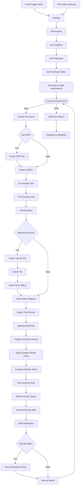

# The n8n Workflow – A to Z

**Workflow:** `Kevin Build Co - Cost Intake (email -> Notion)`
**Runs on:** n8n 2.12.3 (self-hosted, Docker), `http://localhost:5678`
**Source of truth:** generated by `scripts/build-workflow.mjs` → `dist/cost-intake-workflow.json`

This document explains the workflow from start to finish:

- how it starts,
- what every node does and how it is configured,
- what the data looks like at each step,
- how errors are handled,
- how to change it.

For setup and the overall project, see [README.md](README.md).

---

## Contents

- [A. At a glance](#a-at-a-glance)
- [B. Workflow-level settings](#b-workflow-level-settings)
- [C. Credentials](#c-credentials)
- [D. How a run starts (inputs)](#d-how-a-run-starts-inputs)
- [E. The full node map](#e-the-full-node-map)
- [F. Stage 1 – Intake and reference data](#f-stage-1--intake-and-reference-data)
- [G. Stage 2 – The per-document loop](#g-stage-2--the-per-document-loop)
- [H. Stage 3 – Read and understand the document](#h-stage-3--read-and-understand-the-document)
- [I. Stage 4 – Duplicate check and decision](#i-stage-4--duplicate-check-and-decision)
- [J. Stage 5 – Attach the file](#j-stage-5--attach-the-file)
- [K. Stage 6 – Write the cost record](#k-stage-6--write-the-cost-record)
- [L. Stage 7 – Supplier Monthly Summary](#l-stage-7--supplier-monthly-summary)
- [M. Stage 8 – Notification](#m-stage-8--notification)
- [N. Stage 9 – Result and response](#n-stage-9--result-and-response)
- [O. How data moves between nodes](#o-how-data-moves-between-nodes)
- [P. Error handling and reliability](#p-error-handling-and-reliability)
- [Q. Worked example: one invoice, three emails](#q-worked-example-one-invoice-three-emails)
- [R. Reading an execution in n8n](#r-reading-an-execution-in-n8n)
- [S. How to change the workflow](#s-how-to-change-the-workflow)
- [T. Going live checklist](#t-going-live-checklist)
- [U. Connections table](#u-connections-table)
- [V. Glossary](#v-glossary)

---

## A. At a glance

```
TRIGGERS          Email Trigger (IMAP) | Test Intake Webhook
SETUP             Settings → Get Projects → Get Suppliers → Get Employees → Get Purchase Orders
SPLIT             Normalize & Split Attachments  (1 item per document)
LOOP (1 at a time)
  READ            Current Document → Has PDF? → Extract PDF Text → Parse & Match → AI Extraction Slot
  DECIDE          Find Existing Cost → Decide Action
  FILE            Upload Document? → Create Upload Slot → Attach File → Send File to Notion
  WRITE           Build Notion Payload → Upsert Cost Record → Append Audit Note
  SUMMARY         Prepare Summary Recalc → Query Supplier-Month Costs → Compute Monthly Totals
                  → Find Summary Row → Build Summary Upsert → Upsert Summary Row
  NOTIFY          Build Notification → Should Notify? → Send Notification Email
  RESULT          Record Result → (back to loop)
FINISH            Build Run Report → Respond to Webhook
```

| Count | |
|---|---|
| Functional nodes | **35** |
| Sticky notes (documentation on the canvas) | 8 |
| Code nodes | 15 |
| HTTP Request nodes (all Notion API) | 12 |
| IF nodes | 3 |
| Other | IMAP trigger, Webhook, Split in Batches, Extract From File, No-op, Send Email, Respond to Webhook |

---

## B. Workflow-level settings

| Setting | Value | Why |
|---|---|---|
| `executionOrder` | `v1` | Branches run to completion one after another, so the loop is predictable |
| `saveDataSuccessExecution` | `all` | Successful runs are kept, so every run can be inspected and shown in a demo |
| `saveManualExecutions` | `true` | Manual test runs are kept too |
| Active | yes | Needed for the production webhook URL and the IMAP trigger |

---

## C. Credentials

| Credential name | Type | Used by | Created by |
|---|---|---|---|
| `Notion - Kevin Build Co` | Notion API (`notionApi`) | all 12 HTTP Request nodes | `npm run deploy` (from `NOTION_TOKEN`) or by hand |
| `Gmail IMAP - cost intake` | IMAP | Email Trigger (IMAP) | `npm run deploy` when `GMAIL_APP_PASSWORD` is set |
| `Gmail SMTP - cost intake` | SMTP | Send Notification Email | same |

The Notion credential adds `Authorization: Bearer <token>` to each request. Every Notion node also sends the header `Notion-Version: 2022-06-28`.

If the IMAP or SMTP credential doesn't exist, the deploy script **disables** that node. A disabled node just passes its data through, so the rest of the workflow still runs.

---

## D. How a run starts (inputs)

### D1. Email Trigger (IMAP) – real use

| Parameter | Value |
|---|---|
| Mailbox | `INBOX` |
| Search | `["UNSEEN", ["TO", "samisiam851+costs@gmail.com"]]`: only **unread** mail sent **to the +costs address** |
| After reading | mark as **read** |
| Format | `resolved`: full email, with attachments as binary data (`attachment_0`, `attachment_1`, …) |

Gmail delivers `samisiam851+costs@gmail.com` into the normal inbox. The filter means the workflow only ever reads those emails.

### D2. Test Intake Webhook – tests and demo

| Parameter | Value |
|---|---|
| Method / path | `POST /webhook/cost-intake` |
| Respond | *Using 'Respond to Webhook' node*. The caller waits and receives the run report |

Body (JSON):

```json
{
  "from": "apex.timber.frames@example.com",
  "fromName": "Apex Timber Accounts",
  "subject": "Invoice INV-78102 - RIV-001 Riverside Home",
  "text": "Please find attached our invoice...",
  "date": "2026-10-28T09:12:00Z",
  "messageId": "<demo-s01@cost-intake.test>",
  "attachments": [
    { "fileName": "Apex-INV-78102.pdf", "mimeType": "application/pdf", "base64": "JVBERi0xLjQK..." }
  ]
}
```

Both triggers connect to the same next node, **Settings**. From there on, the workflow treats both sources the same way.

---

## E. The full node map



---

## F. Stage 1 – Intake and reference data

### F1. Settings (Code)

Returns **one item** that holds all configuration. Every later node reads it with `$('Settings').first().json`.

```js
{
  db: { projects, contacts, employees, costs, summary, orders },  // Notion database ids
  notionVersion: '2022-06-28',
  companyDomain: 'kevinbuild.co',     // senders from here are staff, not suppliers
  baseCurrency: 'USD',
  dateOrder: 'MDY',                   // 03/04/2026 = March 4
  timezone: 'America/New_York',       // defines "today"
  highValueThreshold: 25000,          // >= this is flagged for approval
  maxUploadBytes: 5242880,            // Notion free-plan upload limit
  demoMode: true,                     // all emails -> demoRecipient with a demo banner
  demoRecipient: 'samisiam851@gmail.com',
  senderEmail: 'samisiam851@gmail.com',
  intakeAddress: 'samisiam851+costs@gmail.com'
}
```

**This is the only node you need to edit to change how the workflow behaves.**

### F2–F5. Get Projects / Get Suppliers / Get Employees / Get Purchase Orders (HTTP Request)

| Node | Request | Body |
|---|---|---|
| Get Projects | `POST /v1/databases/{db.projects}/query` | `{ page_size: 100 }` |
| Get Suppliers | `POST /v1/databases/{db.contacts}/query` | `{ page_size: 100, filter: { or: [Type = Supplier, Type = Subcontractor] } }` |
| Get Employees | `POST /v1/databases/{db.employees}/query` | `{ page_size: 100 }` |
| Get Purchase Orders | `POST /v1/databases/{db.orders}/query` | `{ page_size: 100 }` |

These four nodes have the same settings:

- **Execute Once = on:** each runs **once per execution**, however many emails arrived.
- **Pagination:** sends `start_cursor = {{$response.body.next_cursor}}` until `{{ !$response.body.has_more }}`, for up to 20 pages. More than 100 projects or suppliers still works.
- **Retry on fail:** 3 tries, 1.5 s apart.

They output Notion's raw query responses (`{ results: [...pages], has_more, next_cursor }`). Later Code nodes flatten them with `flattenQueryResults()`.

### F6. Normalize & Split Attachments (Code)

Turns *emails* into *documents*.

1. Works out which trigger fired: `$('Test Intake Webhook').isExecuted`.
2. For each email, builds a common `email` object:
   `{ from, fromName, subject, text, date, messageId }`.
   - "from" is read whether it's an IMAP address object or a `"Name <x@y>"` string.
   - HTML-only emails are converted to text.
3. **Skips** emails whose subject starts with `[DEMO]`, so the workflow never processes its own notifications.
4. Collects the attachments:
   - **Webhook:** base64 is converted to binary with `this.helpers.prepareBinaryData(...)`.
   - **IMAP:** the binaries are already attached; file sizes are read from the metadata.
5. Classifies each attachment as `pdf`, `image` or `other`. Small signature images such as `image001.png` or `logo.png` are dropped.
6. Outputs **one item per document**:

```js
{
  json: {
    email: {...},
    docIndex: 0, docCount: 1,
    hasPdf: true,
    attachment: { fileName, mimeType, kind: 'pdf'|'image'|'other', sizeBytes },  // null if body-only
    submissionId: '<message-id>#0'
  },
  binary: { document: <the file> }   // absent for body-only
}
```

An email with no attachment becomes **one body-only document**, e.g. a field employee typing "Receipt #4471, $245.10" in the email.

---

## G. Stage 2 – The per-document loop

### G1. Loop Over Documents (Split in Batches v3, batch size 1)

- **Output "loop"** → *Current Document*: one document at a time.
- **Output "done"** → *Build Run Report*: once every document is finished. It receives every result item that was fed back in.

**Why one at a time?** Two invoices from the same supplier in the same month, in one email, must not both read the summary row before either writes. Processing them one after another prevents that, and it also makes each execution easy to follow in the n8n editor.

### G2. Current Document (Code)

```js
return $input.all();
```

A pass-through "anchor" node. Later nodes in the loop always read the current document with `$('Current Document').first()`, including its binary file. That works even after HTTP nodes have replaced the item with Notion's response.

---

## H. Stage 3 – Read and understand the document

### H1. Has PDF? (IF, boolean)

`{{ $json.hasPdf }}` is true → *Extract PDF Text*. Otherwise (photo, other file, body only) → straight to *Parse & Match*.

### H2. Extract PDF Text (Extract From File, operation *Extract From PDF*)

- Reads the binary property `document` and outputs `{ text, numpages, info, ... }`.
- **On Error: continue (regular output).** A broken or encrypted PDF doesn't stop the run. *Parse & Match* sees there is no text and the cost is flagged *"PDF has no readable text"*.

### H3. Parse & Match (Code, about 38 KB including the shared helpers)

This is the "brain". It calls `prepareSubmission()` from `src/lib/pipeline.cjs`:

1. **Reference data:** `toReferenceData()` turns the four Get… responses into simple lists: projects `{id, name, code, address, stage, pmId}`, contacts, employees, orders `{po, projectId}`.
2. **Extraction (`extractFields`, rules only):**
   - If the PDF text came back as one long line, line breaks are restored before the label keywords.
   - **Document reference:** labelled (*Invoice No / # / Receipt # / Ref*) or a pattern like `INV-78102`.
   - **Amount:** *Total Due / Amount Due / Balance Due* → *Grand/Invoice Total / Total* → *Amount Paid* → a single unlabelled `$` amount. Subtotals are never used.
   - **Currency:** code or symbol next to the amount → `Currency:` label → only code in the text → `USD`.
   - **Document date:** labelled date (lines mentioning "due" are skipped) → first date in the document → email date (flagged).
   - **Due date:** labelled → calculated from *Net N* / *due on receipt*.
   - **Status:** Paid / Unpaid / Partially Paid / Unknown (rules in README §3.4).
   - **Also captured:** PO number, document type (Invoice/Receipt/…), description.
3. **Supplier (`matchSupplier`):** sender email → sender domain (only if unique and not Gmail/Outlook/example) → Contact name in the document → unknown. Staff senders (`@kevinbuild.co`) are recorded as *submitted by*, and the supplier comes from the document text instead.
4. **Project (`matchProject`):** code → PO (Materials & Orders) → name → site address → distinctive keyword. If several projects match at the same level, the result is **ambiguous**, so no project is set and the cost is flagged.
5. Adds `parsed.dedupeKey = buildDedupeKey(parsed)`.

Output: the document item plus `parsed`:

```js
parsed: {
  docRef: 'INV-78102', docType: 'Invoice', description: 'Roof trusses - stage 2',
  amount: 8450, currency: 'USD', status: 'Unpaid',
  docDate: '2026-10-28', docDateSource: 'document', dueDate: '2026-11-27', dueSource: 'terms',
  supplierName: 'Apex Timber & Frames', supplierContactId: 'e9cab2fe-…', supplierMethod: 'sender email',
  projectId: 'c763269f-…', projectName: 'Riverside Home', projectMethod: 'project code', projectPmId: '…',
  dedupeKey: 'apex timber & frames|inv-78102',
  fromEmail, subject, messageId, receivedAt, sourceEmail, attachmentKind, …
}
```

### H4. AI Extraction Slot (optional) (No-op)

Does nothing today. It's there on purpose, with a sticky note, to show **where an LLM step would go**:

- Replace it with an AI or HTTP node that runs only when `parsed` is missing fields, such as amount or reference.
- Merge the AI's answer back into `$json.parsed`.

Everything after this node keeps working unchanged.

---

## I. Stage 4 – Duplicate check and decision

### I1. Find Existing Cost (HTTP Request)

`POST /v1/databases/{db.costs}/query`

```json
{ "page_size": 1, "filter": { "property": "Dedupe Key", "rich_text": { "equals": "apex timber & frames|inv-78102" } } }
```

Returns `results: []` (new document) or `[existingPage]`.

### I2. Decide Action (Code)

Calls `decideAction(parsed, existingPage, cfg, today)` from `src/lib/decide.cjs`. "Today" is calculated in the `timezone` set in Settings.

| Case | Action | What is written |
|---|---|---|
| No existing page | **create** | All fields. `Submission Count = 1`, `Update Log = "<date> - Created from email …"`. Review flags from the rules |
| Existing page, nothing new | **duplicate** | Only `Submission Count +1`, `Update Log`, `Source Message ID`. Nothing else changes |
| Existing page, something changed | **update** | Only the changed fields, plus `Summary Key`, `Needs Review`, `Review Reason`, `Submission Count`, `Update Log`, `Source Message ID` |

**Update rules:**

- **Payment status only moves forward** (Unknown → Unpaid → Partially Paid → Paid). An older "Unpaid" copy after a payment is ignored and flagged.
- **Amount changed** → applied **and** flagged (`Amount changed on resubmission: 3,200.00 -> 3,450.00`).
- **Currency changed** (when explicit in the document) → applied and flagged.
- **Project:** filled in if it was empty. If the new email points to a *different* project, the record isn't changed and is flagged.
- Empty values never overwrite existing ones.
- `Needs Review` stays ticked if a person hasn't cleared it yet.

**Review rules** (`assessReview`), checked against the *merged* record:

- amount missing or ≤ 0
- reference missing
- date missing, or taken from the email
- no project, or ambiguous
- project Completed
- supplier unknown
- status Unknown
- non-USD currency
- amount ≥ $25,000
- unpaid and past due
- photo (no OCR)
- unsupported file type
- unreadable PDF
- file too large

The node also sets:

- `uploadDocument`: true when the action isn't *duplicate*, there is a PDF or image, and it is ≤ 5 MB.
- `decision.recalc`: which summary rows to recalculate, as `{ key, supplierName, supplierContactId, month, currency }`. There are two rows when an update moved the cost to another month or currency.

---

## J. Stage 5 – Attach the file

### J1. Upload Document? (IF, boolean)

`{{ $json.uploadDocument }}` → true: upload the file; false: go straight to *Build Notion Payload*.

### J2. Create Upload Slot (HTTP Request)

`POST /v1/file_uploads` with body `{ "mode": "single_part", "filename": "...", "content_type": "application/pdf" }`. Returns `{ id, status: "pending" }`.

### J3. Attach File (Code)

The HTTP node replaced the item with Notion's response, which removed the binary file. This node puts it back:

```js
return [{ json: { uploadId: slot.id }, binary: $('Current Document').first().binary }];
```

### J4. Send File to Notion (HTTP Request, multipart/form-data)

`POST /v1/file_uploads/{uploadId}/send`, sending the form field `file` from the binary property `document`. Returns `{ id, status: "uploaded" }`.

*Create Upload Slot* and *Send File to Notion* both use **On Error: continue**. If the upload fails, the cost is still recorded, and *Build Notion Payload* flags *"Document could not be uploaded to Notion (…)"*.

---

## K. Stage 6 – Write the cost record

### K1. Build Notion Payload (Code)

- **Reads:** the decision from `$('Decide Action')` and the upload result from its own input.
- **If the upload succeeded:** adds `Document = [{ type: "file_upload", file_upload: { id }, name }]`.
- **If it failed:** adds the review reason.
- **Builds the request:**
  - create → `{ method: 'POST', url: '/v1/pages', body: { parent: { database_id: db.costs }, properties } }`
  - update or duplicate → `{ method: 'PATCH', url: '/v1/pages/{existingId}', body: { properties } }`
- **Builds the audit note** for the page body:
  - a **callout** (📥 create, 🔁 update, ♻️ duplicate, ⚠️ needs review) listing what was extracted, the match methods, the changes and the review reasons,
  - for creates, a **quote** block with the original email text.

### K2. Upsert Cost Record (HTTP Request – dynamic)

| Field | Expression |
|---|---|
| Method | `{{ $json.request.method }}` (POST or PATCH) |
| URL | `{{ $json.request.url }}` |
| Body | `{{ JSON.stringify($json.request.body) }}` |

One node handles create, update and duplicate. Notion returns the **full page**, and later nodes reuse that response.

### K3. Append Audit Note (HTTP Request)

`PATCH /v1/blocks/{page id}/children` with the audit blocks. **On Error: continue**, because a missing note must not stop the cost from being counted.

---

## L. Stage 7 – Supplier Monthly Summary

**Principle: never add to the totals; always recompute them from the cost records.**

### L1. Prepare Summary Recalc (Code)

Outputs one item per row in `decision.recalc`, usually 1 and sometimes 2.

### L2. Query Supplier-Month Costs (HTTP Request, paginated)

`POST /v1/databases/{db.costs}/query`, filtered on `Summary Key` equals e.g. `apex timber & frames|2026-10|USD`. This returns every cost for that supplier, month and currency.

### L3. Compute Monthly Totals (Code)

- Groups the responses per target, using the item index, or `pairedItem` when pagination returned several pages.
- **Removes** the just-written page from the query results and **adds the copy returned by *Upsert Cost Record***. Notion's search index can lag a few seconds behind a write, so this guarantees the totals include the current version.
- `computeTotals()`:
  - Paid → `paid`
  - Unpaid, Partially Paid and Unknown → `unpaid`
  - pages are counted once (by id)
  - amounts are rounded to cents

Output: `{ target, totals: { paid, unpaid, total, count, unpaidCount } }`.

### L4. Find Summary Row (HTTP Request)

`POST /v1/databases/{db.summary}/query`, filtered on `Summary Key` equals, `page_size: 1`.

### L5. Build Summary Upsert (Code)

- `summaryProperties()` builds:
  - `Summary` = "Apex Timber & Frames - Oct 2026 (USD)"
  - `Supplier` (relation to Contacts)
  - `Supplier Name`, `Month` (1st of the month), `Month Key`, `Currency`
  - `Total Paid`, `Total Unpaid`, `Cost Count`
  - `Summary Key`, `Last Recalculated`
- Then builds the request: PATCH the existing row, or POST a new one.

### L6. Upsert Summary Row (HTTP Request – dynamic)

Same pattern as *Upsert Cost Record*.

---

## M. Stage 8 – Notification

### M1. Build Notification (Code, Execute Once)

- **Execute Once**, because there may be two summary items but only one email should be built.
- Looks up the project name, and the people: the project manager via Projects → Project Manager → Employees, the **Office Admin** (Denise) and the **Owner** (Kevin).
- Calls `buildNotification()`:

| Situation | Intended recipients | `send` |
|---|---|---|
| create / update, clean | project manager | true |
| create / update, needs review | project manager + office admin + Kevin | true |
| no project manager found | office admin + Kevin | true |
| duplicate | – | **false** |

- **Subject:** `[DEMO] Needs review - Cost recorded: Home Depot | 4471 | USD 245.10 | Skyline Development`
- **HTML body:**
  - the yellow **"This is a demo. In production this email would be sent to: …"** banner (demo mode),
  - a table of the fields,
  - a red box with the review reasons,
  - the changes from a resubmission,
  - the recalculated monthly totals,
  - a link to the Notion record.
- **Demo mode:** `to` = `samisiam851@gmail.com`. **Production:** `to` = the real recipients.

### M2. Should Notify? (IF, boolean)

`{{ $json.notification.send }}`

### M3. Send Notification Email (Send Email v2.1, SMTP)

| Parameter | Value |
|---|---|
| From | `{{ $('Settings').first().json.senderEmail }}` |
| To | `{{ $json.notification.to }}` |
| Subject | `{{ $json.notification.subject }}` |
| Format | HTML: `{{ $json.notification.html }}` |
| Append n8n attribution | off |
| On Error | continue: a mail problem never undoes the Notion work |

---

## N. Stage 9 – Result and response

### N1. Record Result (Code)

Builds one clean result line per document and sends it back to the loop:

```json
{
  "submissionId": "<demo-s03@cost-intake.test>#0",
  "file": "Apex-INV-78102-PAID.pdf",
  "action": "update",
  "supplier": "Apex Timber & Frames", "docRef": "INV-78102",
  "amount": 8450, "currency": "USD", "status": "Paid",
  "docDate": "2026-10-28", "dueDate": "2026-11-27",
  "project": "Riverside Home",
  "needsReview": false, "reviewReasons": [],
  "changes": ["Payment status: Unpaid -> Paid"],
  "submissions": 2,
  "notionUrl": "https://app.notion.com/p/...",
  "summaries": [{ "key": "apex timber & frames|2026-10|USD", "paid": 8450, "unpaid": 33900, "count": 2 }],
  "notification": { "sent": true, "to": "samisiam851@gmail.com", "subject": "[DEMO] Cost updated: ...", "intendedRecipients": ["mike@kevinbuild.co"] }
}
```

`notification.sent` is true only if the SMTP server accepted the message. If the email node is disabled, this is reported honestly: `"email node disabled or no SMTP credential"`.

### N2. Build Run Report (Code) → N3. Respond to Webhook

When the loop is done, all result lines are combined into `{ processed: N, results: [...] }` and returned to the webhook caller.

For IMAP runs there is no caller. *Respond to Webhook* is set to **On Error: continue**, so that doesn't cause an error.

---

## O. How data moves between nodes

Two n8n behaviours shape the design:

1. **An HTTP Request node replaces the item** with the API response. So the "state" of the document is carried by **Code nodes**, and later nodes read it back with `$('Node Name').first().json`:

| Read from | Holds |
|---|---|
| `$('Settings')` | configuration and database ids |
| `$('Get Projects' / 'Get Suppliers' / 'Get Employees' / 'Get Purchase Orders')` | reference data (ran once) |
| `$('Current Document')` | the email, attachment info and **binary file** of the current iteration |
| `$('Parse & Match')` | `parsed` |
| `$('Decide Action')` | `decision`, `uploadDocument`, `existingPageId`, `today` |
| `$('Build Notion Payload')` | final `decision` + audit blocks |
| `$('Upsert Cost Record')` | the Notion page as just written (id, url, properties) |
| `$('Compute Monthly Totals')` | recalculated totals |
| `$('Build Notification')` | the notification |

2. **Inside the loop, `$('X').first()` returns the latest run of X.** Every anchor node above runs in **every** iteration, so the reference always points to the current document.

The upload branch doesn't run every time. That's why *Build Notion Payload* doesn't use `$('Send File to Notion')`; it looks at its own input instead (`object === 'file_upload' && status === 'uploaded'`).

**Where the shared logic lives.** The big Code nodes contain:

- their own short logic at the top, in `function run()`,
- then the helpers from `src/lib/*.cjs`, appended by the build,
- and finally `return run();`.

The same helpers are unit-tested (`npm test`), so the code in n8n is exactly the code that was tested. To change it, **edit `src/` and run `npm run build && npm run deploy`**. Don't edit the Code nodes directly in n8n, because the next deploy overwrites them.

---

## P. Error handling and reliability

| Risk | Protection |
|---|---|
| Notion rate limit (≈3 req/s) or a temporary 5xx error | Every HTTP node: **Retry on Fail**, 3 tries, 1.5 s apart. Documents are processed one at a time |
| More than 100 projects/suppliers/costs | Pagination on all list queries (up to 20 pages) |
| Broken or scanned PDF | Extract From File continues on error; the cost is flagged |
| File upload fails or file > 5 MB | Upload nodes continue on error; the cost is still recorded and flagged |
| Audit note fails | Continues; the cost and summary are unaffected |
| Email fails | Continues; reported in the result as `sent: false` with the error |
| Same email processed twice (re-read, forwarded, resent) | Dedupe Key → *duplicate* → only the count changes |
| Re-runs or retries inflating totals | Summary is **recomputed**, never incremented |
| Notion search lag right after a write | Totals use the page returned by the write, not the search result |
| Two documents for the same supplier/month in one email | Loop processes them one by one |
| Workflow emailing itself in a loop | `[DEMO]` subjects are skipped; IMAP only reads mail sent to `+costs` |
| Wrong project guessed | Ambiguous matches are never guessed; the cost is flagged |

What is **not** protected (see README §9): two *separate executions* at the same instant for the same supplier/month, and IMAP marking an email as read before a failed run.

---

## Q. Worked example: one invoice, three emails

**Email 1** (s01): Apex Timber emails invoice **INV-78102** for **$8,450**, *Net 30*, subject containing **RIV-001**.

| Step | Result |
|---|---|
| Normalize | 1 document (PDF) |
| Extract | ref INV-78102 · 2026-10-28 · $8,450 USD · Unpaid · due 2026-11-27 (Net 30) |
| Match | supplier = Apex Timber & Frames (*sender email*) · project = Riverside Home (*project code*) |
| Find Existing | none → **create** |
| File | PDF uploaded and attached to `Document` |
| Summary | `apex timber & frames|2026-10|USD` → paid 0 · unpaid 42,350 (existing Joinery invoice 33,900 + 8,450) · 2 costs |
| Notify | Mike Johnson (PM of Riverside) → in demo: samisiam851@gmail.com |

**Email 2** (s02): the same email forwarded again.

| Step | Result |
|---|---|
| Find Existing | found, all fields equal → **duplicate** |
| Written | Submission Count 2, Update Log "Duplicate submission ignored" |
| Summary | recomputed, **unchanged** |
| Notify | none |

**Email 3** (s03): Apex sends the **PAID** copy (*Amount Paid $8,450, Balance Due $0.00*).

| Step | Result |
|---|---|
| Extract | status **Paid** (balance due 0) |
| Find Existing | found → **update**: `Payment status: Unpaid -> Paid` |
| Summary | paid 8,450 · unpaid 33,900 · still **2** costs: the amount moved, it wasn't added |
| Notify | "Cost updated" to the PM |

Result: **one** record for INV-78102 in Notion, with all three emails in its Update Log, and correct totals.

---

## R. Reading an execution in n8n

1. Open the workflow → **Executions** tab → click a run.
2. Click any node to see its **input and output** data:
   - **Parse & Match** → `parsed`: what was read from the document, and *how* the supplier and project were matched (`supplierMethod`, `projectMethod`).
   - **Decide Action** → `decision.action`, `decision.changes`, `decision.newReviewReasons`.
   - **Upsert Cost Record** → the Notion page (`url` opens it).
   - **Compute Monthly Totals** → the recalculated totals.
   - **Build Notification** → `notification.subject`, `.to`, `.intendedRecipients`.
3. The loop shows a run counter on each node. Use the run selector to step through documents.

---

## S. How to change the workflow

| I want to… | Do this |
|---|---|
| Change currency, threshold, timezone, demo recipient, go live | Edit `src/nodes/settings.js` → `npm run build && npm run deploy` (or edit the **Settings** node in n8n) |
| Add a review rule | Add a line to `assessReview()` in `src/lib/decide.cjs` → add a unit test → `npm test` → build + deploy |
| Recognise a new label (e.g. "Amt Payable") | Add it to `AMOUNT_LABELS` / `extractDocRef` labels in `src/lib/extract.cjs` → test → build + deploy |
| Add a project | Add it in Notion with a `Project Code`. No workflow change needed (loaded each run) |
| Add a supplier | Add it to Contacts (Type = Supplier/Subcontractor, with Email). No workflow change needed |
| Add AI extraction | Replace **AI Extraction Slot** with an AI node, used only when `parsed` is missing fields; merge its output into `$json.parsed` |
| Use Outlook / Microsoft 365 instead of Gmail | Replace the IMAP trigger with the Microsoft Outlook trigger and adjust *Normalize & Split* (email shape) |
| Notify by Slack/Teams too | Add a node after **Should Notify?** (true branch) using `$json.notification` |
| Nightly safety recalculation | Add a Schedule Trigger workflow that runs the same summary rebuild as `scripts/summary-sync.mjs` |

---

## T. Going live checklist

- [ ] `GMAIL_APP_PASSWORD` in `.env` → `npm run deploy`, so the IMAP and SMTP nodes are enabled
- [ ] Real email addresses on Employees (Denise, Kevin, the project managers)
- [ ] Settings: `demoMode: false`, `senderEmail` = the company mailbox
- [ ] Suppliers in Contacts have their real invoicing email addresses (best supplier match)
- [ ] Tell suppliers and staff to put the **project code** in the subject (e.g. `RIV-001`)
- [ ] Run n8n with a **persistent volume** (`-v n8n_data:/home/node/.n8n`)
- [ ] `npm run scenarios` then `npm run verify` on a test copy; `npm run reset:demo` afterwards
- [ ] Workflow **Active**

---

## U. Connections table

| From | Output | To |
|---|---|---|
| Email Trigger (IMAP) | main | Settings |
| Test Intake Webhook | main | Settings |
| Settings | main | Get Projects |
| Get Projects | main | Get Suppliers |
| Get Suppliers | main | Get Employees |
| Get Employees | main | Get Purchase Orders |
| Get Purchase Orders | main | Normalize & Split Attachments |
| Normalize & Split Attachments | main | Loop Over Documents |
| Loop Over Documents | **done** (0) | Build Run Report |
| Loop Over Documents | **loop** (1) | Current Document |
| Current Document | main | Has PDF? |
| Has PDF? | true | Extract PDF Text |
| Has PDF? | false | Parse & Match |
| Extract PDF Text | main | Parse & Match |
| Parse & Match | main | AI Extraction Slot (optional) |
| AI Extraction Slot (optional) | main | Find Existing Cost |
| Find Existing Cost | main | Decide Action |
| Decide Action | main | Upload Document? |
| Upload Document? | true | Create Upload Slot |
| Upload Document? | false | Build Notion Payload |
| Create Upload Slot | main | Attach File |
| Attach File | main | Send File to Notion |
| Send File to Notion | main | Build Notion Payload |
| Build Notion Payload | main | Upsert Cost Record |
| Upsert Cost Record | main | Append Audit Note |
| Append Audit Note | main | Prepare Summary Recalc |
| Prepare Summary Recalc | main | Query Supplier-Month Costs |
| Query Supplier-Month Costs | main | Compute Monthly Totals |
| Compute Monthly Totals | main | Find Summary Row |
| Find Summary Row | main | Build Summary Upsert |
| Build Summary Upsert | main | Upsert Summary Row |
| Upsert Summary Row | main | Build Notification |
| Build Notification | main | Should Notify? |
| Should Notify? | true | Send Notification Email |
| Should Notify? | false | Record Result |
| Send Notification Email | main | Record Result |
| Record Result | main | Loop Over Documents |
| Build Run Report | main | Respond to Webhook |

---

## V. Glossary

| Term | Meaning |
|---|---|
| **Document** | One thing to record: a PDF, a photo, or an email body with no attachment |
| **Dedupe Key** | `supplier|invoice no.`: identifies the same document across emails |
| **Summary Key** | `supplier|YYYY-MM|currency`: identifies one Supplier Monthly Summary row |
| **create / update / duplicate** | New cost / existing cost with changes / exact repeat (ignored) |
| **Needs Review** | A person should check this record; the reasons are in `Review Reason` |
| **Demo mode** | All notifications go to one address, with a banner naming the real recipients |
| **Execute Once** | n8n node setting: run for the first item only, once per execution |
| **Upsert** | Update if it exists, otherwise create |
| **Anchor node** | A Code node whose output later nodes read with `$('Name')` to recover data that HTTP nodes replaced |
