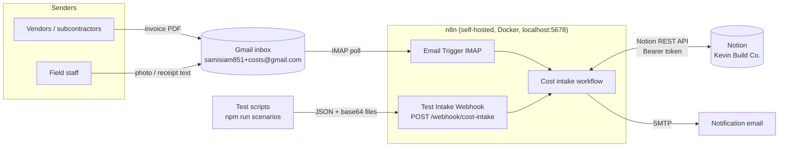
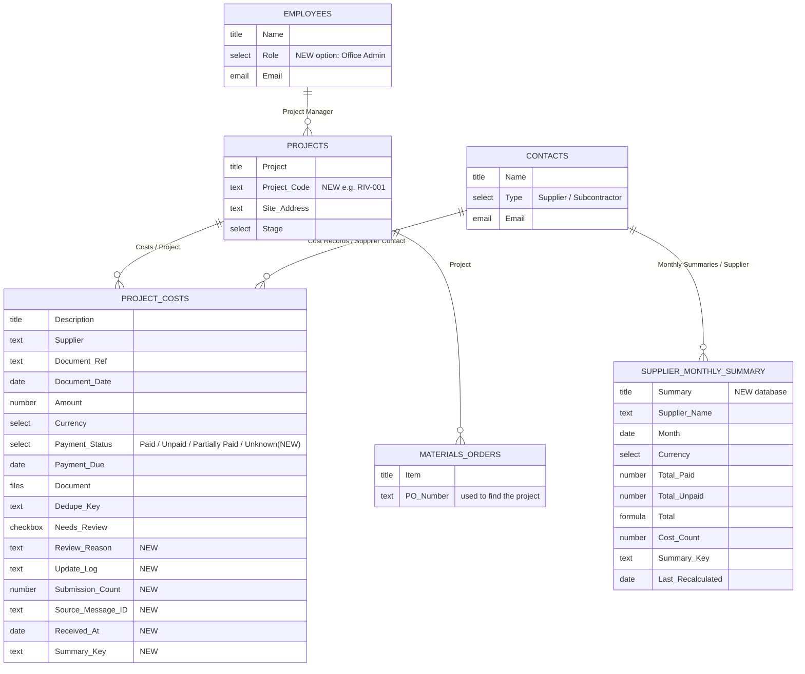
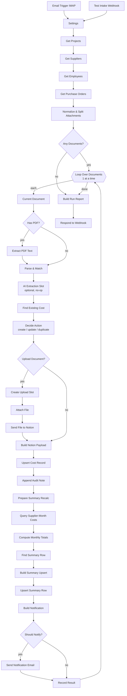
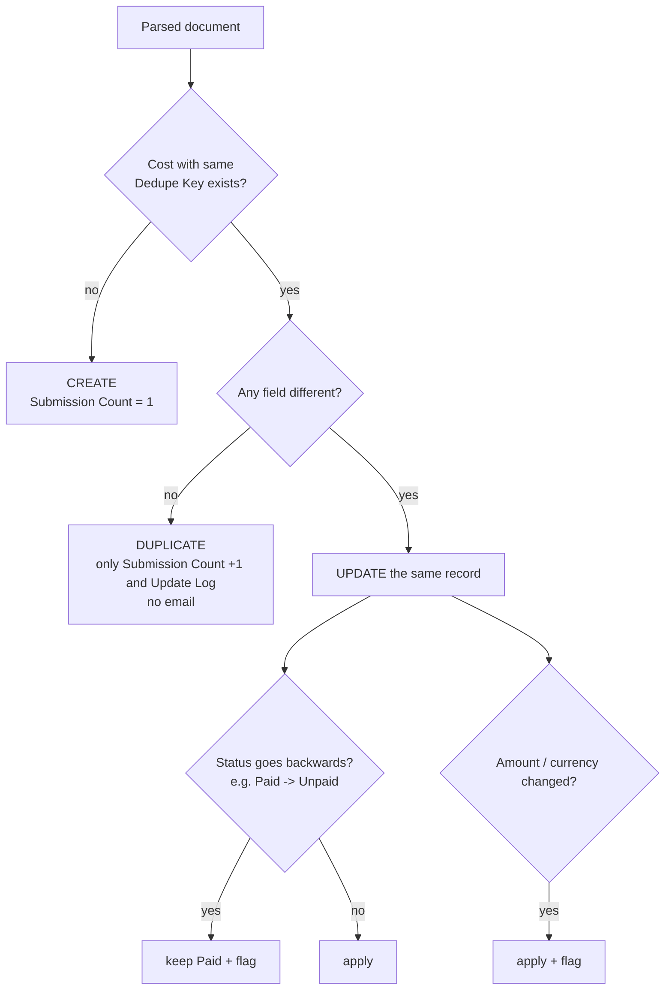
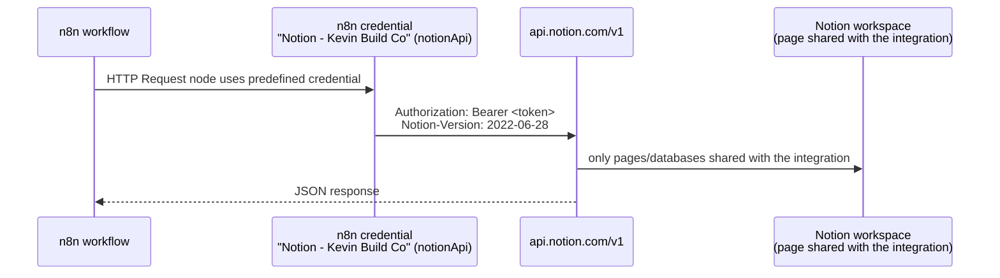

# Kevin Build Co. – Construction Cost Intake (n8n + Notion)

**Assessment Part 3 – Integration & Automation**

Turns emailed receipts and invoices into project cost records in Notion. Duplicates are caught, unclear items are flagged for review, the right person is notified, and the Supplier Monthly Summary stays up to date. It all runs on free plans.

---

> **Node-by-node walkthrough of the n8n workflow:** see [N8N-WORKFLOW.md](N8N-WORKFLOW.md).

## Contents

- [Kevin Build Co. – Construction Cost Intake (n8n + Notion)](#kevin-build-co--construction-cost-intake-n8n--notion)
  - [Contents](#contents)
  - [1. What it is](#1-what-it-is)
  - [2. Why it exists (the purpose)](#2-why-it-exists-the-purpose)
  - [3. How it works (architecture)](#3-how-it-works-architecture)
    - [3.1 System overview](#31-system-overview)
    - [3.2 Notion data model](#32-notion-data-model)
    - [3.3 The n8n workflow, node by node](#33-the-n8n-workflow-node-by-node)
    - [3.4 Extraction and matching rules](#34-extraction-and-matching-rules)
    - [3.5 Duplicate, update and review logic](#35-duplicate-update-and-review-logic)
  - [4. How Notion is connected to n8n](#4-how-notion-is-connected-to-n8n)
  - [5. How to set it up](#5-how-to-set-it-up)
    - [5.1 Prerequisites](#51-prerequisites)
    - [5.2 Notion integration](#52-notion-integration)
    - [5.3 n8n API key](#53-n8n-api-key)
    - [5.4 `.env` (in this folder, never committed)](#54-env-in-this-folder-never-committed)
    - [5.5 Prepare Notion](#55-prepare-notion)
    - [5.6 Put the workflow into n8n](#56-put-the-workflow-into-n8n)
    - [5.7 Configuration](#57-configuration)
  - [6. How to run it](#6-how-to-run-it)
    - [6.1 Real use – by email](#61-real-use--by-email)
    - [6.2 Test webhook](#62-test-webhook)
    - [6.3 Commands](#63-commands)
    - [6.4 Live demo (about 5 minutes)](#64-live-demo-about-5-minutes)
  - [7. Testing](#7-testing)
  - [8. Design decisions](#8-design-decisions)
  - [9. Known limitations](#9-known-limitations)
  - [10. Project layout](#10-project-layout)
  - [11. Troubleshooting](#11-troubleshooting)

---

## 1. What it is

An **n8n workflow** plus a small **supporting project** (this folder).

| Piece | Where it lives | Role |
|---|---|---|
| The automation | Inside n8n (`Kevin Build Co - Cost Intake (email -> Notion)`) | Does the actual work every time an email arrives |
| The data | Notion (the Part 2 workspace "Kevin Build Co.") | Projects, suppliers, staff, cost records, monthly summary |
| This folder | Your computer / Git repo | Setup scripts, the workflow's source code, tests, demo tools, documentation |

For every receipt or invoice that arrives by email, the workflow:

1. **Reads** the email and each attachment (PDF text, photo, or the email body itself).
2. **Extracts** the supplier, document reference, date, amount, currency, payment status and due date.
3. **Links** the cost and its file to the correct **construction project**.
4. **Checks for duplicates**. It creates a new record, updates the existing one, or ignores an exact repeat.
5. **Flags** anything a person should check.
6. **Notifies** the project manager. Items needing review go to the office admin and Kevin.
7. **Recalculates** that supplier's paid and unpaid totals for the month in **Supplier Monthly Summary**.

---

## 2. Why it exists (the purpose)

Kevin's company builds custom homes. Costs arrive from many directions: suppliers email invoices, subcontractors send progress claims, and field staff email photos of receipts. Some are paid and some aren't. Some are sent twice, and some are corrected later.

Typing these into Notion by hand is slow and error-prone. The usual problems:

- the same invoice is entered twice,
- a cost isn't linked to its job, so job costing is wrong,
- nobody notices an invoice is overdue,
- it's unclear what the company owes each supplier this month.

This automation addresses each of those:

| Assessment requirement | Where it's handled |
|---|---|
| Process incoming emails and attached receipts/invoices | Email Trigger (IMAP) → *Normalize & Split Attachments* |
| Extract supplier, reference, date, amount, currency, payment status | *Extract PDF Text* → *Parse & Match* |
| Link each cost and document to the correct project | *Parse & Match* (project matching) + Notion File Upload |
| Track paid/unpaid and due dates | `Payment Status`, `Payment Due` (from the document or terms such as *Net 30*) |
| Handle duplicates and updates without double counting | *Find Existing Cost* → *Decide Action* (create / update / duplicate) |
| Flag submissions needing review | `Needs Review` + `Review Reason` |
| Notify the appropriate person | *Build Notification* → *Send Notification Email* |
| Update Supplier Monthly Summary | *Query Supplier-Month Costs* → *Compute Monthly Totals* → *Upsert Summary Row* |
| Work on free plans | n8n Community Edition (self-hosted) + Notion Free (file uploads ≤ 5 MB) |

---

## 3. How it works (architecture)

### 3.1 System overview



### 3.2 Notion data model

The Part 2 databases are **reused**. Part 3 only adds fields, plus one new database.



Two keys make the logic reliable:

| Key | Format | Used for |
|---|---|---|
| `Dedupe Key` (cost) | `supplier|invoice no.`, e.g. `apex timber & frames|inv-78102`. Without an invoice number: `supplier|no-ref|date|amount` | Finding an earlier submission of the same document |
| `Summary Key` (cost and summary) | `supplier|YYYY-MM|currency`, e.g. `apex timber & frames|2026-10|USD` | Finding every cost that belongs to one summary row |

### 3.3 The n8n workflow, node by node



| # | Node | Type | What it does |
|---|---|---|---|
| 1 | **Email Trigger (IMAP)** | IMAP trigger | Polls Gmail for **unread** mail sent **to** `samisiam851+costs@gmail.com` only, and marks each one read |
| 1 | **Test Intake Webhook** | Webhook | Same input as JSON (used by the tests and the live demo) |
| 2 | **Settings** | Code | All configuration in one place: Notion database ids, company domain, base currency, date order, review threshold, demo mode, demo recipient |
| 3 | **Get Projects / Suppliers / Employees / Purchase Orders** | HTTP → Notion | Loads reference data **once per run**, with pagination |
| 4 | **Normalize & Split Attachments** | Code | Turns each email into one item per document (PDF, photo, or the body if there is no attachment). Skips signature images and the workflow's own `[DEMO]` emails |
| 5 | **Loop Over Documents** | Split in Batches (1) | Handles documents **one at a time**, so two invoices from the same supplier and month can't clash on the summary |
| 6 | **Extract PDF Text** | Extract From File | Gets the PDF's text (errors are caught, and an unreadable PDF is flagged) |
| 7 | **Parse & Match** | Code | Rule-based extraction, then supplier and project matching (see 3.4) |
| 8 | **AI Extraction Slot** | No-op | Marked placeholder for an optional LLM step |
| 9 | **Find Existing Cost** | HTTP → Notion | Looks up an existing cost by `Dedupe Key` |
| 10 | **Decide Action** | Code | Chooses **create**, **update** or **duplicate**, and applies the review rules (see 3.5) |
| 11 | **Create Upload Slot → Attach File → Send File to Notion** | HTTP + Code | Uploads the PDF or photo using Notion's File Upload API |
| 12 | **Build Notion Payload → Upsert Cost Record** | Code + HTTP | Creates (POST) or updates (PATCH) the cost page |
| 13 | **Append Audit Note** | HTTP → Notion | Adds a note to the page body: what was extracted, what changed, why it was flagged, plus the original email |
| 14 | **Prepare Summary Recalc → … → Upsert Summary Row** | Code + HTTP | Recalculates the affected Supplier Monthly Summary row(s) from the cost records |
| 15 | **Build Notification → Should Notify? → Send Notification Email** | Code + IF + SMTP | Builds and sends the email |
| 16 | **Record Result → Build Run Report → Respond to Webhook** | Code | Returns one result line per document to the caller |

### 3.4 Extraction and matching rules

**Extraction is rule-based, with no AI.** It's free, gives the same answer every time, and can be tested.

| Field | Rule (in priority order) |
|---|---|
| Document reference | Labelled: *Invoice No / Invoice # / Receipt # / Ref*. Otherwise a pattern such as `INV-78102`, `CH-INV-9910`. Dates are never taken as references |
| Amount | *Total Due / Amount Due / Balance Due* → *Grand Total / Invoice Total / Total* → *Amount Paid* → a single unlabelled `$245.10`. **Subtotals are ignored.** If *Balance Due* is 0, the total is used |
| Currency | Code next to the amount (`USD`, `EUR`, …) → symbol (`€`, `£`, `A$`) → `Currency:` label → base currency (USD) |
| Document date | *Invoice Date / Date / Issued* (lines mentioning "due" are skipped) → first date in the document → email received date (flagged) |
| Due date | *Due Date / Payment Due / Pay by* → calculated from terms (*Net 30*, *due on receipt*) |
| Payment status | *Unpaid / Overdue* → *Partially paid* → *Balance Due 0 / Paid in full / Payment received / PAID stamp / paid by card* → *Amount Due / Due Date / Net N* = Unpaid → a plain receipt = Paid → otherwise **Unknown** |
| Supplier | Sender email matches a Contact → sender domain (if unique and not Gmail/Outlook) → a Contact name appears in the document → **unknown** (named from a "Supplier:" label, "at Home Depot", the sender name, or the first line; then flagged). Emails from `@kevinbuild.co` are treated as **staff submitting a cost**, not as a supplier |
| Project | Project code (`RIV-001`, also `riv001`, `RIV 1`) → **PO number from Materials & Orders** → project name → site address (`Drive` = `Dr`) → distinctive keyword ("Skyline"). If two projects match equally well, nothing is guessed and the cost is flagged |

### 3.5 Duplicate, update and review logic



**Review flags** (`Needs Review` = ✔, with the reasons listed in `Review Reason`):

- amount missing or ≤ 0
- invoice number missing
- document date missing
- no project matched, or more than one matched
- project is Completed
- supplier not in Contacts
- payment status unclear
- currency other than USD
- amount ≥ $25,000
- unpaid and past due
- photo or scanned receipt (no OCR)
- unreadable PDF
- file too large for Notion
- amount or currency changed on resubmission
- a newer document conflicts with the recorded status or project
- the file upload failed

**Notifications:**

| Situation | Who (production) | Demo mode |
|---|---|---|
| Cost recorded/updated | Project manager (Projects → Project Manager → Employees email) | Sent to `samisiam851@gmail.com`, with a **"This is a demo"** banner naming the real recipients |
| Needs review | Office admin (Denise) **and** Kevin (Owner) | same |
| Exact duplicate | nobody | – |

**Supplier Monthly Summary:** the affected row is recalculated from **all** cost records with the same `Summary Key`. It is never incremented. Paid counts as paid; Unpaid, Partially Paid and Unknown count as unpaid. If an update moves a cost to another month or currency, **both** rows are recalculated. The cost just written is taken from Notion's response rather than from a search, so a slow Notion index can't give stale totals.

---

## 4. How Notion is connected to n8n

**The connection is an n8n credential that holds a Notion integration token.** Nothing in this folder is needed at runtime.



1. **Notion side:** an *internal integration* was created at notion.so/profile/integrations. Its token can only see pages that were explicitly shared with it, here the **Kevin Build Co.** page (••• → Connections), including every database under it.
2. **n8n side:** that token is stored, encrypted, as an n8n credential of type **Notion API** (`notionApi`). `npm run deploy` creates it from `.env`; you can also create it by hand in n8n → Credentials.
3. **Workflow:** every Notion call is an **HTTP Request** node with *Authentication = Predefined credential type → Notion API*, plus a `Notion-Version: 2022-06-28` header. Each node retries 3 times on errors and rate limits.

**Why HTTP Request nodes instead of n8n's built-in Notion node?** The built-in node can't use Notion's **File Upload API**, which is needed to attach the PDF. HTTP Request nodes also let one node either create or update a record, and they show the exact API calls being made.

**Notion API calls used by the workflow**

| Endpoint | Node(s) | Purpose |
|---|---|---|
| `POST /v1/databases/{id}/query` | Get Projects/Suppliers/Employees/Purchase Orders, Find Existing Cost, Query Supplier-Month Costs, Find Summary Row | Read reference data; look up by `Dedupe Key` / `Summary Key` |
| `POST /v1/file_uploads` | Create Upload Slot | Start a file upload |
| `POST /v1/file_uploads/{id}/send` | Send File to Notion | Send the PDF/photo (multipart) |
| `POST /v1/pages` | Upsert Cost Record, Upsert Summary Row | Create a cost or a summary row |
| `PATCH /v1/pages/{id}` | Upsert Cost Record, Upsert Summary Row | Update a cost or a summary row |
| `PATCH /v1/blocks/{id}/children` | Append Audit Note | Add the audit note to the page body |

The setup scripts additionally use `POST /v1/search`, `GET/PATCH /v1/databases/{id}`, `POST /v1/databases` and `GET /v1/blocks/{id}`.

**How this folder talks to n8n:** only `npm run deploy`, through the **n8n public API** (`X-N8N-API-KEY`). It creates the credentials, creates or updates the workflow and activates it. The test scripts call the workflow's **webhook**.

---

## 5. How to set it up

### 5.1 Prerequisites

- **Node.js 20+** (for the scripts; tested with Node 24)
- **n8n**, self-hosted (tested with **n8n 2.12.3** in Docker on port 5678)
  ```bash
  # recommended: with a volume so workflows/credentials survive container removal
  docker run -d --name n8n -p 5678:5678 -v n8n_data:/home/node/.n8n docker.n8n.io/n8nio/n8n
  ```
- A **Notion** workspace with the Part 2 databases (Projects, Contacts, Employees, Project Costs, Materials & Orders)
- Optional: a **Gmail** account with 2-Step Verification (for real email in and out)

### 5.2 Notion integration

1. Go to **notion.so/profile/integrations → New integration**, type **Internal**, then copy the *Internal Integration Secret*.
2. Open the **Kevin Build Co.** page → **•••** → **Connections** → add your integration.

### 5.3 n8n API key

In n8n, go to **Settings → n8n API → Create an API key**.

### 5.4 `.env` (in this folder, never committed)

```env
NOTION_TOKEN=ntn_xxx                          # step 5.2
NOTION_PARENT_PAGE_URL=https://www.notion.so/Kevin-Build-Co-xxxxxxxx
N8N_BASE_URL=http://localhost:5678
N8N_API_KEY=xxx                               # step 5.3
GMAIL_APP_PASSWORD=xxxx xxxx xxxx xxxx        # optional: Google Account → Security → App passwords
# GMAIL_ADDRESS=samisiam851@gmail.com         # optional, this is the default
```

### 5.5 Prepare Notion

```bash
npm run setup:notion
```

This only adds what's missing, so it's safe to re-run. It never deletes or renames Part 2 fields.

- **Projects:** adds `Project Code` and fills it in (RIV-001, SKY-001, HBR-001, LKC-001, OAK-001, MPL-001).
- **Employees:** adds the role `Office Admin` and **Denise**.
- **Project Costs:** adds the new fields and the `Unknown` status, then backfills the existing Part 2 rows.
- **Supplier Monthly Summary:** creates the database next to Project Costs and fills it from the existing costs.
- Writes the database ids to `config/notion-ids.json`.

### 5.6 Put the workflow into n8n

**Option A – automatic (recommended)**

```bash
npm run deploy
```

This builds `dist/cost-intake-workflow.json` and creates these n8n credentials:

- `Notion - Kevin Build Co`
- if `GMAIL_APP_PASSWORD` is set: `Gmail SMTP - cost intake` (smtp.gmail.com:465) and `Gmail IMAP - cost intake` (imap.gmail.com:993)

It then creates or updates the workflow and **activates** it. Without Gmail credentials, the two email nodes stay **disabled** and everything else works through the webhook.

**Option B – manual import**

1. `npm run build`.
2. In n8n, go to **Workflows → Import from file** and choose `dist/cost-intake-workflow.json`.
3. Create the credentials (Notion API, SMTP, IMAP) and select them in the nodes that show a warning.
4. Enable *Email Trigger (IMAP)* and *Send Notification Email*, then **Activate**.

### 5.7 Configuration

Everything you can change is in the **Settings** node (source: `src/nodes/settings.js`):

| Setting | Default | Meaning |
|---|---|---|
| `companyDomain` | `kevinbuild.co` | Senders from this domain are staff, not suppliers |
| `baseCurrency` | `USD` | Assumed for `$`; other currencies are flagged |
| `dateOrder` | `MDY` | How `03/04/2026` is read |
| `timezone` | `America/New_York` | Used for "today" (overdue check, logs) |
| `highValueThreshold` | `25000` | At or above this amount, the cost is flagged for approval |
| `maxUploadBytes` | 5 MB | Notion free-plan upload limit |
| `demoMode` | `true` | All emails go to `demoRecipient` with a demo banner |
| `demoRecipient` | `samisiam851@gmail.com` | Demo inbox |
| `intakeAddress` | `samisiam851+costs@gmail.com` | The only address the IMAP trigger reads |

To go live: set `demoMode: false` and give Employees real email addresses.

---

## 6. How to run it

### 6.1 Real use – by email

Send an invoice or receipt to **samisiam851+costs@gmail.com**. Put the project code in the subject when you can, e.g. `Invoice INV-123 - RIV-001`. The IMAP trigger picks it up within about a minute. Then:

- the cost appears in **Project Costs**, with the PDF attached,
- **Supplier Monthly Summary** is updated,
- a notification email arrives.

Only *unread* mail **to the +costs address** is read, so the rest of the inbox is never touched.

### 6.2 Test webhook

```bash
curl -X POST http://localhost:5678/webhook/cost-intake \
  -H 'Content-Type: application/json' \
  -d '{
    "from": "apex.timber.frames@example.com",
    "fromName": "Apex Timber Accounts",
    "subject": "Invoice INV-90001 - RIV-001",
    "text": "Invoice INV-90001\nInvoice Date: 10/30/2026\nTotal Due: $1,250.00\nTerms: Net 30",
    "date": "2026-10-30T09:00:00Z",
    "messageId": "<manual-1@test>",
    "attachments": []
  }'
```

`attachments` items take the form `{ "fileName": "x.pdf", "mimeType": "application/pdf", "base64": "..." }`.

The response lists, for every document: the action taken, the extracted fields, the project, the review reasons, the Notion link, the updated summary, and the notification status.

### 6.3 Commands

| Command | What it does |
|---|---|
| `npm test` | 37 unit tests of the logic (no network) |
| `npm run setup:notion` | Prepare Notion (section 5.5) |
| `npm run build` | Generate `dist/cost-intake-workflow.json` |
| `npm run deploy` | Build, create credentials, and import + activate in n8n |
| `npm run scenarios` | Send the 11 test emails to the live workflow and check the results (`-- s01 s03` to pick some) |
| `npm run verify` | Check Notion: no duplicate records, and every summary row equals its cost records |
| `npm run reset:demo` | Move the test records to Notion's trash and recalculate summaries (Part 2 data untouched) |

### 6.4 Live demo (about 5 minutes)

1. `npm run reset:demo`. Open n8n and Notion (Project Costs + Supplier Monthly Summary) side by side.
2. `npm run scenarios -- s01`: show the n8n execution, then the new cost with its PDF and audit note, the summary row, and the email.
3. `npm run scenarios -- s02 s03`: the duplicate is ignored, then the **same** record changes to Paid, and the summary moves $8,450 from unpaid to paid.
4. `npm run scenarios -- s05 s10`: review flags, and the corrected amount.
5. Send a real PDF to samisiam851+costs@gmail.com.
6. `npm run verify`.

---

## 7. Testing

| Layer | How | Result |
|---|---|---|
| **Unit** | `npm test` (node:test). Runs the **same code** that is inlined into the n8n Code nodes | **37/37 pass** (incl. 7 regression tests from the edge suite): dates, amounts, currencies, status, subtotal vs total, flattened PDF text, project codes, supplier matching, create/duplicate/update, status never goes backwards, amount change flagged, totals, notification recipients |
| **End-to-end** | `npm run scenarios`. Real PDFs and a PNG are generated and sent to the live webhook; each result is checked | **11/11 pass** (report in `test/output/scenario-report.md`) |
| **Edge cases** | `npm run scenarios -- --suite edge`. 33 adversarial cases designed and reviewed by separate agents (`test/output/edge-case-review.md`) | **33/33 pass** after fixing 7 bugs found in run 1 (`test/output/test-run-report.md`) |
| **Data consistency** | `npm run verify`. Independent read-back from Notion | **Consistent**: 13 records, 13 unique dedupe keys; all 10 summary rows match the recomputed totals |

| # | Scenario | Expected and observed |
|---|---|---|
| s01 | New unpaid invoice (PDF), code in subject | created · Unpaid · due 2026-11-27 (Net 30) · Riverside Home · PDF attached · PM notified |
| s02 | Same invoice emailed again | **duplicate** · count 2 · totals unchanged · no email |
| s03 | Same invoice re-sent marked PAID | **same record** Unpaid → Paid · summary moves $8,450 to paid |
| s04 | Field employee, receipt in email body | created · Home Depot (new supplier → review) · Skyline (keyword) · Paid |
| s05 | No project reference, already overdue | created · flagged *No project matched* + *overdue* |
| s06 | Only a PO number | project via **Materials & Orders PO-1044** → Skyline Development |
| s07 | Progress claim without amount | created · flagged *Amount not found* |
| s08 | Overseas supplier, EUR | separate EUR summary row · flagged currency + new supplier |
| s09→s10 | Corrected invoice, new amount | same record $3,200 → $3,450 · flagged *Amount changed* |
| s11 | Phone photo of a receipt | photo attached · flagged *no OCR – check manually* |

---

## 8. Design decisions

| Decision | Why |
|---|---|
| **Rules instead of AI** for extraction | Free, the same answer every time, testable and explainable. Anything uncertain is **flagged, not guessed**. A marked *AI Extraction Slot* shows where an LLM could be added for low-confidence documents |
| **Reuse Part 2 databases** | Costs land on the same Projects, Contacts and Employees the team already uses. No second copy of the data |
| **Recompute summaries, never increment** | Re-running, retrying or updating can never double-count |
| **One document per loop iteration** | No race between two documents for the same supplier and month in one run; easier to follow in n8n |
| **Status only moves forward** | An old "unpaid" copy arriving after the payment can't undo it |
| **Dedupe Key = supplier + invoice no.** | The same convention already used in the Part 2 data |
| **HTTP Request nodes for Notion** | Needed for file uploads, allow create-or-update in one node, and show the exact API calls |
| **Logic in `src/lib`, inlined at build time** | One source of truth: the code that's unit-tested is the code n8n runs |
| **Demo mode** | Safe to demonstrate with placeholder staff emails, while still showing who would be notified |
| **IMAP filtered to the `+costs` address** | The automation never touches the rest of the inbox |

---

## 9. Known limitations

- **Rule-based extraction:** unusual layouts or wording can miss a field. When that happens the item is flagged for review, never silently wrong.
- **No OCR:** photos and scanned PDFs are attached and flagged for manual entry.
- **Formats:** US dates are assumed for ambiguous dates like `03/04/2026` (configurable). European amounts (`1.234,56`, `222,64`) are read correctly, but an ambiguous `1.234` without decimals is read as 1.234. Currencies aren't converted; each currency has its own summary row.
- **Partially Paid** counts as unpaid in full (documents rarely state the paid portion). **Credit notes** are recorded as their own **negative** cost (e.g. −450) and flagged; they are not linked automatically to the invoice they correct.
- **Duplicates:** these rely on supplier + invoice number. If one supplier appears under two names, a duplicate can slip through. Without an invoice number, the key falls back to supplier + date + amount, and the cost is flagged.
- **Concurrency:** two *separate* runs at the same moment for the same supplier and month could both create a summary row. `npm run verify` detects this and `reset:demo` / `setup:notion` repair it. A nightly full recalculation would remove the risk in production.
- **Edits made by hand in Notion** don't trigger the workflow. The summary refreshes on the next submission for that supplier and month.
- **IMAP marks mail as read when fetched:** if a run fails, the email isn't retried automatically. It stays visible in n8n's execution list.
- **Free-plan limits:** Notion uploads ≤ 5 MB, and about 3 API requests/second. Each document takes about 5–8 s, which is fine for an office's volume.
- **Hosting:** local n8n only runs while the computer and Docker are on. The current container has **no volume**, so its data is lost if the container is deleted. Keep `dist/` and use `npm run deploy` to restore.
- Staff emails `@kevinbuild.co` are Part 2 placeholders; demo mode sends everything to one real address.

---

## 10. Project layout

```
notion-project/
├── README.md                     this document
├── package.json                  npm commands (section 6.3)
├── .env                          secrets (git-ignored)
├── config/
│   └── notion-ids.json           Notion database ids (generated by setup:notion)
├── dist/
│   └── cost-intake-workflow.json importable n8n workflow (generated by build)
├── src/
│   ├── lib/                      shared logic, unit-tested, inlined into n8n
│   │   ├── extract.cjs           rule-based field extraction
│   │   ├── match.cjs             supplier + project matching
│   │   ├── notion.cjs            Notion property helpers
│   │   ├── pipeline.cjs          email + text → cost record; who to notify
│   │   ├── decide.cjs            review rules, dedupe, create/update/duplicate
│   │   ├── summary.cjs           monthly totals + summary properties
│   │   └── notify.cjs            notification email (demo banner)
│   └── nodes/                    the body of each n8n Code node
├── scripts/
│   ├── notion-setup.mjs          extend the Part 2 workspace (safe to re-run)
│   ├── build-workflow.mjs        generate the n8n workflow JSON
│   ├── deploy-workflow.mjs       credentials + import + activate via the n8n API
│   ├── run-scenarios.mjs         live end-to-end tests through the webhook
│   ├── verify-notion.mjs         consistency check of the Notion data
│   ├── reset-demo.mjs            remove test records, recalculate summaries
│   ├── summary-sync.mjs          full summary rebuild (used by setup/reset)
│   ├── notion-api.mjs            small Notion client with retry
│   └── lib-bundle.mjs            bundles src/lib for n8n and tests
└── test/
    ├── unit/                     node:test unit tests
    ├── fixtures/                 11 scenarios, reference data, PDF/PNG generators
    └── output/                   scenario report + generated files (git-ignored)
```

---

## 11. Troubleshooting

| Symptom | Cause / fix |
|---|---|
| `Could not find database` / `object_not_found` | The Kevin Build Co. page isn't shared with the integration (••• → Connections) |
| Webhook returns 404 | Workflow not active. Run `npm run deploy` or toggle *Active* in n8n |
| Notification shows "email node disabled or no SMTP credential" | Add `GMAIL_APP_PASSWORD` to `.env` and run `npm run deploy` |
| Gmail login rejected | Use an **app password** (requires 2-Step Verification), not the normal password; IMAP must be enabled in Gmail settings |
| Real email not picked up | It must be **unread** and sent **to** `samisiam851+costs@gmail.com`; the workflow must be active |
| Logic changed but n8n behaves the same | Run `npm run build && npm run deploy` (the Code nodes are generated) |
| Summary looks wrong after hand edits | Run `npm run verify`; `npm run reset:demo` (or `setup:notion`) rebuilds all summaries |

---

